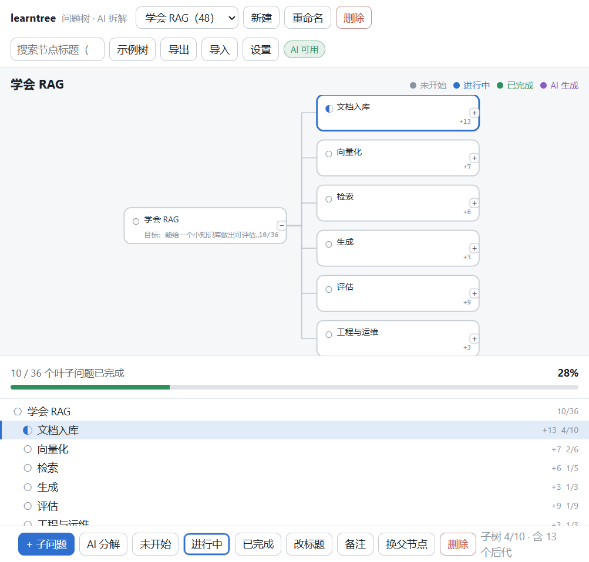

# learntree（树状图 AI 学习平台）

[](https://github.com/IMUskyworld/learntree/actions/workflows/ci.yml)

**把学习过程中冒出来的问题画成一棵树，AI 只负责一件事：帮你把它拆开。**

学一个陌生领域时，困难不是一条直线，而是一棵树：「学会 RAG」→「检索」→「怎么评估检索质量」→
「nDCG 到底在算什么」。大多数人用一个扁平 to-do 清单记这些，于是看不出卡在哪一层、
不知道已经解决了多少、也没人帮你把大问题拆成能动手的小问题。

learntree 的模型很直接：

- 根节点 = 你的学习目标；
- 中间节点 = 拆出来的子问题 / 知识点；
- 叶子节点 = 可以直接动手解决的最小问题；
- **进度按叶子算**：解决一个叶子，树上的进度才真的亮一块。



| | |
| --- | --- |
| 纯静态 | 手写 HTML/CSS/ES Module，零构建、零依赖、零打包。`python -m http.server` 就能跑 |
| 本地优先 | 数据在浏览器 localStorage，导出/导入 JSON 走天下。没有账号、没有服务端、没有遥测 |
| AI 可选 | 不配任何密钥，建树/改状态/进度/折叠/搜索全部可用；配了才解锁「AI 分解」 |
| AI 只做拆解 | 一个节点 → 3–6 个子问题，带理由式提示。讲解/出题/诊断是后续里程碑，MVP 不碰 |
| 采纳前可编辑 | AI 给的东西先进预览弹窗：逐条勾选、就地改标题，确认后才写进树 |
| 不装懂 | 模型返回空列表/坏 JSON/全重复 → 明确报错并说明「你的树没有被修改」，绝不静默当成功 |
| 密钥不外流 | API key 只进 localStorage 和请求头；导出文件默认剥掉它；设置页能看到将要发送的完整 payload（密钥打码） |

## 快速开始

**在线演示**：<https://imuskyworld.github.io/learntree/>（GitHub Pages；不配密钥也能完整体验，数据依然只存在你的浏览器里）

```powershell
cd learntree
python -m http.server 8080       # 然后浏览器打开 http://127.0.0.1:8080/
```

> 直接双击 `index.html` 不行 —— 浏览器不允许 `file://` 页面加载 ES Module。
> learntree 会显示一页可读的提示（含上面这条命令），而不是白屏。

打开后点「载入示例树」就能看到一棵 43 个节点的「学会 RAG」问题树。

### 想试试 AI 分解但没有密钥？

```powershell
python scripts/fake_llm.py --port 8931
```

设置里填：地址 `http://127.0.0.1:8931/v1`、模型 `fake`、密钥随便写。
**它返回的是从你的提问里套出来的模板，只能证明链路通，不代表真实模型的拆解质量。**

### 接真模型

设置 → 勾选「启用 AI 分解」→ 填任意 OpenAI 兼容端点（地址 / 模型 / 密钥）。
如果那个端点不开 CORS（多数厂商都不开），起个本地代理：

```powershell
python scripts/llm_proxy.py --port 8932 --upstream https://api.example.com/v1
# 设置里的地址填 http://127.0.0.1:8932/v1
```

## 怎么用（30 秒）

1. 「新建」→ 写下你当前最想搞明白的那件事（这就是根节点）；
2. 选中一个节点 → 「+ 子问题」手动拆，或「AI 分解」让模型给候选再勾选采纳；
3. 选中节点按 `d` 标完成，或点状态按钮；右下角进度按叶子算；
4. 卡住的地方折叠起来（点节点右下角的 `−`），只留你现在要打的分支；
5. 换电脑：「导出」→「导入」。

快捷键：`/` 搜索 · `Enter` 加子问题 · `Tab`/`Shift+Tab` 下钻/回父 · `1/2/3` 切状态 ·
`d` 完成/取消 · `c` 折叠 · `F2` 改标题 · `Delete` 删除（可撤销一次）。

## 命令速查

| 命令 | 作用 |
| --- | --- |
| `python -m http.server 8080` | 打开应用 |
| `node --test` | 核心层单测（99 个，无需 npm install，自动发现 tests/） |
| `python scripts/fake_llm.py --port 8931` | 假 LLM（含 CORS），验收/试用用 |
| `python scripts/llm_proxy.py --port 8932 --upstream <url>` | 真端点的本地 CORS 代理 |
| `python scripts/verify_mvp.py` | §20 完成定义逐条核验（真起 HTTP 服务、真发请求） |
| `powershell -NoProfile -ExecutionPolicy Bypass -File scripts/check.ps1` | 质量闸门 |

`verify_mvp.py` 退出码：`0` 全绿；`1` 有 FAIL。当前输出 **12 PASS / 1 SKIP / 0 FAIL**
（SKIP 是浏览器端到端那条 —— 脚本不自动开浏览器，证据登记在 `DEVELOPMENT.md` §24.6）。

> `check.ps1` 必须带 `-ExecutionPolicy Bypass`：本机默认执行策略会拦 `-File`。

## 数据与安全

- 存储键：`learntree.library.v1`（localStorage）。读坏了**不会覆盖**原内容，只会按空库打开并告诉你发生了什么。
- 导出文件自描述：`{app:"learntree", schemaVersion:1, exportedAt, treeCount, library}`。缺任何一项直接拒收，不猜格式。
- 导出默认剥掉 `apiKey`；只有你显式勾选带密钥时才会写进去，界面也会警告。
- 应用零外部资源引用：没有 CDN、没有网络字体、没有埋点。这条由 `verify_mvp.py` 的静态检查强制（README 顶部的 CI 徽章由 GitHub 自己托管）。
- 发给模型的只有：学习目标、从根到当前节点的路径标题、当前节点标题/备注、已有子节点标题。不发整棵树。

## 已知局限

见 `DEVELOPMENT.md` §24.5：AI 拆解质量只用 DeepSeek 抽测过一轮（§24.7）、布局算法朴素、
只有一次性撤销、没有移动端调优、搜索只匹配标题与备注。

## 文档

- `DEVELOPMENT.md` —— 产品定义、架构、§20 可执行完成定义、§24 实测记录（含浏览器逐小步）
- `docs/protocol.md` —— 数据协议与示例
- `docs/adr/` —— 三个关键决策：为什么零构建、为什么本地优先、为什么 AI 可选
- `docs/known-deviations.md` —— 与规格书的偏差与诚实清单

## English summary

**learntree** turns a learning goal into a *problem tree*: the root is what you want to
understand, leaves are problems small enough to actually solve, and progress counts
solved **leaves** — so marking a parent "done" can't inflate your score.

AI does exactly one thing: decompose a node into 3–6 sub-problems, shown in a preview
dialog where you uncheck and edit before anything is written to the tree. A model that
returns nothing usable is reported as a failure, never silently treated as "no
sub-problems needed".

It is a hand-written static web app: no build step, no npm dependencies, no telemetry,
no external resources. Data lives in `localStorage` with self-describing JSON
export/import; the API key never leaves your browser except in the request header.
Everything works with no AI configured.
